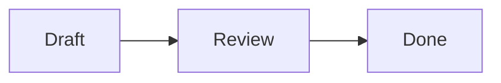

# Labradorite guide

This guide describes **Labradorite Space 2026.1.0 development builds**. The
published stable **v1.5.0** is the earlier notebook and does not include the
Space plugin shell, Library or the later embed work. Development
builds are stamped `2026.1.0+dev`; this guide does not announce a new release.

Labradorite runs locally in your browser. The optional Notes plugin
uses a shared rail, settings, command palette and vault. Notes are plain
Markdown files in a folder you choose. Notes offers visual editing, Markdown
source, Preview and Split, search, Light/Dark/System appearance and browser
draft recovery.

Labradorite is AI-assisted software. Keep important notes backed up and try it on
a copy of your vault first.

The first time it starts without a vault argument, Labradorite creates its notebook
with a short **Welcome to Labradorite** note; delete it whenever you like. Folders
you open yourself are never given one.

## Run it

Release archives on the [Releases](https://github.com/eg36/Labradorite/releases)
page hold the `labradorite` binary; run it from the unpacked folder. To build it
instead, Go **1.26+** is the only requirement. Browser assets are bundled and
committed: Node and npm are **not** needed to run the app, and there are no CDNs
or automatic runtime third-party requests. Opt-in web embeds contact external
services only when explicitly loaded.

```sh
git clone git@github.com:eg36/Labradorite.git
cd Labradorite
go build -o bin/labradorite ./cmd/labradorite
./bin/labradorite
```

The app opens **http://127.0.0.1:4280** in your default browser; a current
Chrome/Chromium, Firefox or Safari works. The terminal prints the address and
vault path too. Keep that process running while
using the app; Ctrl+C stops it. There is no account, cloud sync, telemetry,
database or remote access mode.

**Install it as an app:** Chrome and Edge offer *Install Labradorite* in the
address bar or menu. The installed app opens in its own window with the
Labradorite icon; it still needs `labradorite` running to work.

### Choose a vault

```sh
./bin/labradorite ~/Notes                  # open an existing Markdown vault
./bin/labradorite -data-dir /tmp/test      # isolated notes AND app settings
./bin/labradorite -listen 127.0.0.1:4390   # choose another local port
./bin/labradorite -no-browser              # print the address without opening it
./bin/labradorite -version
```

Flags go **before** the optional vault path. The app only accepts loopback
listeners; it cannot be exposed on `0.0.0.0`, a LAN IP or a public host. Browser
and server must be on the same computer. This is not a hosted multi-user service.

The default vault is:

- Linux: `$XDG_DATA_HOME/labradorite`, or `~/.local/share/labradorite`.
- macOS: `~/Library/Application Support/labradorite` (not verified on a Mac).
- Windows: `%AppData%\labradorite` (native CI coverage in test builds).

Labradorite was called coyotenote until v0.6.1. On its first start without
`-data-dir`, it moves the former default folder (`coyotenote-web` beside the new
one) to the new name, once. If coyotenote is still running on that folder, or
the move fails, it keeps using the old folder and says so. Browser drafts kept
under the old folder's path are refiled under the new one.

With an explicit vault, appearance and enabled-plugin choices stay in the default
data directory. Web-embed permission belongs to the active vault. `-data-dir`
changes the settings directory and, without a positional vault, the vault too.
Only one Labradorite process can open a vault at a time; a second one is refused.

## Labradorite Space

### Switch tools and manage plugins

The nine-dot button below the Labrador logo opens the plugin switcher. Press
**Alt+P**, then a number shown beside a plugin, or use ↑/↓ and Enter. Escape
closes it and returns focus to the button. The command palette also offers
**Switch plugin…** and **Switch to Notes**. The active plugin supplies
its own rail actions and commands; **F1** shows its shortcuts alongside the
shared shortcuts.

**Settings → Plugins** enables or disables Notes, which is enabled
when no saved choice exists. Disabling it keeps its files. With no plugin
enabled, the empty workspace links to these settings; Settings, Commands and
Library remain available. Plugins are built in; external plugin installation
is not supported. The last active plugin is remembered in this browser per vault.

All ordinary Markdown files appear in Notes, including files in an existing
`issues/` folder. The former Issues plugin is no longer included; its files
remain editable as notes, and wiki links to them open in Notes.

### Library

Open **Library** from the bottom rail, **Alt+L**, or the **Open the library**
command. It lists files by kind: Notes, Attachments and Other files,
with their folder, size and modified date. The filter matches names and folders.
Hidden folders, symlinks and app settings are omitted.

Selecting a Markdown file opens Notes when Notes is enabled.
Files without an available opener download instead. Library also works with
every plugin disabled. It does not move or delete files.

## Writing in Notes

The Labrador logo and a permanent icon rail sit at the left. The logo returns
to the start page; **Notes** shows or hides the adjacent notes panel. Search,
recent notes, new notes, commands, trash, Library and settings stay reachable when that
panel is closed. Desktop and phone remember their own open/closed preference.
Drag rail icons to reorder them within the main shortcuts or bottom utility group;
Alt+Shift+↑/↓ moves a focused icon too. This browser remembers the order. The logo and plugin switcher stay anchored.

The header is one title row. At its left end, the **notes panel** button shows
or hides the notes panel (its left pane is filled while the panel is open),
followed by **File / Edit / View / Insert**. The menus remain available on the
start page; note-only commands need an open note. Use ↑/↓ within a menu, ←/→
to switch menus, and Escape to close.

In the centre, a status dot shows save state (hover for details; hidden on the
start page), then the folder breadcrumbs and the note title. Click the title to
rename the note in place. The chevron after it opens the note's own menu:
Rename, Move to folder…, Export as Markdown, Version history, All commands and
Move to trash. The pin button follows the chevron. Hover or focus a truncated
title to read its full path; on narrower windows the folder path is hidden and
the title shortens instead of covering the menus.

At the right end, the **Write / Markdown / Split / Preview** switch shows the
current view. Click a view, or use ←/→ once it has focus; the **View** menu and
Alt+M switch views too. On phones the title takes the first line and the menus
and view switch share the second; the rail opens the notes drawer.

**Text formatting**, just before the view switch, opens a panel between Notes
and the document.
It groups paragraph styles, bold/italic/strike/code, highlights, lists and
quotes, inserts and undo/redo, followed by labelled tools for the rest of Write:
**Footnote** (the next free number at the caret, with its definition added at
the end of the note, ready to type), **Inline** and **Block** formulas (an
inline formula starts from the selected text), a **Mermaid** diagram (its
starting source is selected for you to replace), **Callout** (wraps the current
paragraph; the arrow beside it picks one of 13 types, and the button remembers
the last one), and **Find and replace** and **Note history**. With a diagram or
formula selected, new content goes after it rather than replacing it. The
tools are disabled while a recovered draft holds the note. Tab enters the panel
at its last-used control; arrows, Home and End move between its tools. It is available in
Write, and closes in source or preview modes.
**PDF, audio or video** opens the attachment picker and inserts the selected
files at the caret. Under **Note**, **Save now** saves pending edits, and
**Properties** focuses the existing fields or raw editor. If the note has no
front matter, Properties starts it with an empty `tags` field.

The Format button or Escape hides it; this browser remembers the choice separately
for desktop and smaller screens. On smaller screens it opens over the content;
click outside to close. Focus mode temporarily hides it too.

The rail's **Search** button (or Ctrl/⌘ Shift E) opens one query field with
**All notes / This note** scopes. Switching scope keeps the query. Escape clears
the query first, then closes search. All notes searches paths and contents;
This note offers find and replace in the current note.

The interface and writing pane use locally bundled **Lexend**. The writing size
defaults to 18 px, Markdown source to 16 px, and small interface labels and shortcut hints
are at least 12 px.

**Settings** (the button at the bottom of the rail, View → Settings…, Quick
open or Ctrl/⌘ Shift T) holds the appearance and, under Writing, text sizes from
14–24 px, Narrow/Standard/Wide line widths for Write and Preview, and spellcheck
in Write. Markdown text stays 2 px smaller than the chosen size. Every change
applies at once and is kept; Done closes the window.
Spelling uses the browser's language and dictionary. Writing preferences stay
in this browser. Appearance and enabled plugins are saved with app settings;
web-embed permission is saved in the active vault. These choices do not rewrite
note contents. Settings also includes Plugins and Web embeds.

- **Write** is a Tiptap WYSIWYG editor. Use the formatting panel or Markdown input rules for
  headings, bold, italic, strike, lists, tasks, quotes, inline/fenced code, links
  and tables. Undo/redo operates on edits, independently of trash restore.
- **Markdown** is CodeMirror with selection, undo, line numbers, syntax colors,
  find, indentation and `[[` note completion. It preserves exact source text,
  including tabs; saving preserves the file's LF or CRLF convention.
- **Preview** is read-only Markdown rendered by Go/Goldmark. External links open
  separately with no referrer. Images from the vault are shown; remote images are
  replaced by their description and never fetched. Raw HTML is cleaned, never executed.
- **Images:** paste or drop an image into Write or Markdown, or use the formatting panel's
  image button, and it is saved in the vault's `attachments/` folder and linked
  with ordinary Markdown, such as ``. PNG, JPEG,
  GIF, WebP, AVIF and SVG images up to 20 MiB are accepted; a pasted screenshot is
  named after the moment it was pasted. Image paths are read relative to the note
  first, then to the vault root. Embeds such as `![[photo.png]]` show in both
  Write and Preview.
- **PDF, audio and video:** use **Insert → PDF, audio or video…**, the
  **Attach a PDF, audio or video file** command, or paste/drop supported files.
  PDFs and MP3, M4A, OGG/OGA, WAV, FLAC, MP4, WebM, MOV and OGV files are
  accepted up to **100 MiB**, with a content check. They stay in `attachments/`.
  `![[report.pdf]]`, `![[talk.mp3]]` and `![[clip.mp4]]` show the local viewer or
  player in Write and Preview. Audio/video seeking uses range requests; actual
  playback depends on the browser's supported codecs.
- **Split** shows source and preview side by side. On narrow screens they stack
  vertically. Each pane scrolls independently.
- **Find and replace** (Edit or Quick open command) searches the open
  note with case, whole-word and regular-expression controls under **Search options**. It opens Markdown
  view from Write or Preview; Split stays split. Replace one match or all,
  then close search to restore the previous writing view. Choosing a view yourself
  during search keeps that choice. Ctrl/⌘+F also opens this panel while the
  Markdown editor has focus. Replacements autosave and can be undone.
- Click the note name to **rename** it in place: the title becomes a field
  containing only the name. Enter saves it in the same folder; Escape, an
  unchanged name or leaving the field cancels. Errors appear beside the field.
  To move it, use **File → Rename or move…** or Ctrl/⌘+Shift+R and enter a path.
  You can also **drag a note** onto a folder, or onto a note in it, to move it
  there; while dragging, a zone at the end of the list moves it out of folders.
  Resolved wiki links in other notes are rewritten to keep pointing at it;
  externally changed files are left alone and reported. The moved note's own
  image links, which are found from its folder, are rewritten too whenever
  they would otherwise show a different image, or none, from the new folder.
- **Tags** come from a `tags` (or `tag`) property in front matter, as a list or
  comma-separated, and from `#tags` in the text outside code; a
  tag needs a letter, so `#2026` is not one. When the vault has tags, click
  **All tags** (#) in the sidebar to see each tag and its note count. Choose a tag
  to filter the note list, or choose All tags inside the list to reset it.
  In Preview, tags are buttons that apply the filter.
- The icons above the notes list open **today's note**, toggle **tags**, and
  **collapse or expand all folders and pins**. The title row or rail Notes
  button closes the panel. **Previous / Next note** in View, the command palette
  or Alt+↑/↓ cycles visible sorted notes; Recently opened records visited notes.
- **Pinned notes** sit below tags and above Notes. Use the pin button after the
  note title or the Pin/Unpin command; this section has compact title/date rows and
  remembers whether it is collapsed. **Recently opened** in the rail shows your
  last 30 opened notes. Pins and recents stay in this browser for this vault;
  renaming or moving through the app follows the note's new path.
- Click a folder's name in the sidebar to **collapse** it. Collapsed folders show
  how many notes they hold and stay collapsed in this browser; searching still
  lists their matches. Opening a note deliberately reveals its folder; reloading
  preserves your collapsed folders.
- **Quick open** (Ctrl/⌘+K, or the footer hint) jumps to a note by a few letters of
  its path, such as `qp` for *Quarterly plan*; matched letters are highlighted.
  Start with `#` to jump to a heading of the open note, or `>` to run a command
  such as a view change, rename or appearance setting. Anything typed can also become a
  content search or a new note.
- **Today's note** (File menu, Quick open command, or Alt+J) opens
  `Journal/YYYY-MM-DD` using your computer's local date, creating an empty note
  when it does not exist. Repeating the command keeps the same note and its text.
- **Templates:** keep reusable notes in a `Templates/` folder. The New note
  dialog's **Start with** menu offers these notes, including subfolders, or a
  blank note. Creating a note copies the selected template's current Markdown,
  including properties, and leaves the original template untouched. Templates
  are ordinary notes; edit them in the same way as any other note.
- The **outline** button (Alt+O) lists the note's headings beside the text,
  indented by level. Click one to bring it into view in any view; the outline
  marks the section you are reading as you scroll. It stays open across reloads
  on wide screens and slides over the text on narrow ones.
- **Search notes** (the rail search icon or Ctrl/⌘ Shift E) matches **paths and note contents** and reveals
  the notes sidebar when you use it. The sort
  menu beside the note count orders notes within each folder by recently edited
  (default), title A–Z or title Z–A, and remembers the choice in this browser.
  **Alt+Up / Alt+Down** (or View → Previous / Next note) cycles the visible sorted notes;
  Recently opened in the rail returns to notes you visited. The backlink count in the footer lists notes
  linking here. Hidden folders and symlinks are skipped.
- **Settings → Appearance** offers three cards: **Light**, **Dark** and
  **System**. Labradorite Light/Dark use slate surfaces and blue accents;
  System follows the operating system's light or dark preference and switches
  as soon as it changes. Click a card, or use the arrow keys, to choose; the
  choice is kept at once. Text colours that would fall below WCAG AA contrast
  are darkened or lightened just enough to pass.
- **View → Focus mode** (Ctrl/⌘ Shift F) hides the sidebar. Small screens get a slide-out notes drawer,
  a Format drawer, stacked split panes and compact status hints.

### Extended syntax

Beyond GitHub Flavored Markdown, Preview understands:

- **Highlights:** `==marked text==`. Start with a colour emoji for a coloured
  highlight: `==🔴red==`, 🟠 orange, 🟡 yellow, 🟢 green, 🔵 blue, 🟣 purple.
  Write shows them too and saves the `==` markers exactly as typed.
- **Comments:** `%%a private note%%` hides text from Preview, inline or as a
  block from a line starting `%%` to the next `%%`. Code keeps its `%%`, and a
  `%%` with no closing pair stays visible. Write shows comments as typed.
- **Footnotes:** `[^1]` or a named `[^source]` marks a reference, and
  `[^1]: text` defines it anywhere in the note (indent further lines by two
  spaces); `^[text]` writes one inline. Preview numbers them and lists them at
  the end; click a number or ↩ to jump between them.
- **Callouts:** a quote starting `> [!type] Title` becomes a coloured box with
  an icon. Types: note, abstract (summary, tldr), info, todo, tip (hint,
  important), success (check, done), question (help, faq), warning (caution,
  attention), failure (fail, missing), danger (error), bug, example and quote
  (cite); others look like a note. `[!type]-` starts folded and `[!type]+`
  open; nest callouts with `> >`. Leave out the body for a title-only callout.
  Write shows callouts as Preview does and edits their body as text. The
  header holds the type, the title (as Markdown) and whether it folds; the
  first line is saved exactly as written until one of those changes. Typing
  `[!type]` and a space at the start of a quote turns it into a callout and
  moves to its title; Enter there moves on to the body. A line that continues
  a callout without starting with `>` keeps the note in Markdown.
- **Links within a note:** `[[#Heading]]` jumps to a heading of the same note,
  and `[[#Heading|label]]` shows a label. End a paragraph or list item with
  ` ^an-id` to name that block, then link to it with `[[Note#^an-id]]` or
  `[[#^an-id]]`; Preview hides the marker. Inside a table cell, write an alias
  with an escaped pipe: `[[Note\|label]]`.
- **Task marks:** besides `- [ ]` and `- [x]`, any single character marks a task:
  `[?]` question, `[!]` important, `[>]` deferred, `[/]` in progress and `[-]`
  cancelled (struck through) show the same coloured marks in Write and Preview.
  Tasks have no list bullet; ordinary bullet lists keep theirs. In Write, the
  chevron beside a mark opens a status picker with readable names, available
  with mouse, touch or keyboard. Clicking an Open or Done checkbox toggles it.
  Untouched markers (including `[X]`),
  bullet spacing and nested task indentation stay exact; changes support undo.
  Type `- [?] ` to start a question task. Tight bullet task lists are supported.
  Custom-status tasks mixed with plain bullets, ordered custom tasks, loose
  custom task lists and continuation paragraphs keep the Markdown fallback so
  their layout remains intact.
- **Image sizes:** end an image's description with a width, or a width and
  height: `![[photo.png|200]]`, `![[photo.png|A trail|200x150]]` or
  ``. With only a width the picture keeps
  its proportions. Write and Preview both show the size.
- **Web embeds:** `![[https://example.com/page]]` embeds a web page;
  YouTube watch, short, live and embed links use the privacy-enhanced player.
  An optional `|label` names the embed. Web embeds are **off by default**.
  Turn on **Settings → Web embeds → Allow web embeds**, then choose **Load
  embed** on each placeholder. The destination is shown before loading; no
  remote frame, thumbnail or player code loads automatically, including after
  a reload. **Unload embed** removes the frame; turning the setting off
  unloads frames in the current tab. The setting stays with the vault.
  General pages use a sandbox and send no referrer. YouTube receives only
  the local app's origin because its player requires a referrer identity;
  note names and paths are never sent. Loaded services receive normal network
  information and may make their own requests. Some sites refuse embedding;
  the visible source link can open them in a browser tab instead.
  Preview and Write show the same controls, and Write keeps the embed source
  exactly when editing surrounding text. Raw HTML iframes stay blocked.
- **Editing embeds in Write:** choose **Edit embed** on a web, note, image or
  media embed. Change **Embed target or URL** and the optional label, then
  **Apply** (or Enter). **Cancel** or Escape leaves the source unchanged.
  Targets can include a heading or block reference; image labels can include
  a size. Applying is one undoable change. A changed web destination unloads
  its old frame and waits for **Load embed** again, including after Undo.
- **Note embeds:** `![[Note]]` shows another note inside this one in Preview,
  `![[Note#Heading]]` just that section and `![[Note#^id]]` just that block,
  with the note's name as a link above. Embeds nest two notes deep; a note
  that would show itself again appears as a link instead.
- **HTML:** formatting tags such as `<u>`, `<sub>`, `<sup>`, `<kbd>`, `<mark>`,
  `<abbr title="…">` and `<details><summary>…</summary>…</details>` show in
  Preview. Write also renders allowed inline tags and blocks as read-only
  content, saving their HTML exactly when editing around them. Scripts, styles,
  raw frames, forms, event handlers, `javascript:` links and remote pictures
  are removed from Preview. Unsupported raw HTML keeps the Markdown fallback.

#### Math and Mermaid
Write inline formulas as `$x^2 + y^2 = z^2$`; the dollar signs must touch the
formula. Money such as `$5 and $6` stays text. Put `$$` on its own lines around
a display formula (or write `$$x^2$$` on one line). Code and escaped dollar
signs stay literal. KaTeX renders the TeX locally; invalid formulas remain
readable with a short explanation on hover.

Write shows formulas rendered too. Click one (or focus it and press Enter) to
edit its TeX in a field below it, with a live rendering; Apply or Ctrl/⌘ Enter
saves, Escape cancels, and undo works as usual. Typing `$a+b$` makes an inline
formula; typing `$$` on an empty line and pressing Enter starts a display
formula. Delimiters, spacing and the TeX itself are saved exactly as written.
Formulas can sit inside bold, italic, strikethrough, highlights and links, and
display formulas inside bullet and numbered lists and quotes. A display
formula written directly below a list or quote, without indenting it, ends
that list or quote in both Preview and Write. Only when that happens inside a
list nested in a quote does the note open in Markdown with a message.

Use a fenced code block with the language `mermaid` for a diagram:

````markdown

````

Diagrams use strict rendering and theme colours in Preview and Write. Click a
diagram in Write (or focus it and press Enter) to edit its Mermaid source below
it, with a live rendering. Apply or Ctrl/⌘ Enter saves, Escape cancels, and undo
works as usual. Its fence, language line and source indentation stay as written.
Invalid diagrams keep their source with an error message and remain editable.
Images, URLs, custom configuration and CSS styling directives are disabled so
rendering stays offline. Both renderers and the math fonts are bundled; their
code loads only when a note needs it, with no CDN or other network service.

### Markdown editor

- **Folding:** point at the line numbers to see a ⌄ beside each heading and
  list; click it to fold that section, and click › or the … marker to unfold.
  Ctrl+Shift+[ and ] (⌘⌥[ and ] on a Mac) fold and unfold at the cursor.
- **Several cursors:** Alt+click adds a cursor, Shift+Alt+drag selects a
  rectangle, and Ctrl/⌘ D selects the next match of the word at the cursor.
  Escape returns to one cursor.

### WYSIWYG round trips

Merely opening Write or switching views **does not save or normalize a note**.

Wiki links such as `[[Note]]`, `[[Folder/Note#Heading|label]]` are preserved by a
custom Markdown node. Click a rendered wiki link to follow it; use the formatting panel to
insert one, or finish typing `[[a note]]`. The source editor suggests existing notes
while typing `[[`. Missing notes can be created from a link.

**Front matter** (a YAML `---` or TOML `+++` block opening the note) shows in
Write as an editable **Properties** box above the text. Write edits only the text
below it, so untouched front matter is saved byte for byte; edited properties keep
the block's delimiter and byte order mark. "Add properties" in Quick open starts
front matter with a `tags` field. Preview shows front matter as a properties
block above the text, and note excerpts and word counts leave it out.

Editing in Write changes only what you edit. Paragraphs, lists, headings,
tables and other blocks you leave alone are saved exactly as they were
written, whatever style they use. Text you edit keeps its backslash escapes,
character references such as `&amp;`, its emphasis delimiters (`_` or `*`,
`~` or `~~`), code spans, autolinks and line breaks. Characters you type are
escaped only where they would otherwise turn into formatting: `snake_case`
stays as typed, while a typed `[a](b)` is saved as `\[a](b)` to stay text.
An edited table row can have its padding compacted; unchanged rows and the
delimiter row keep their original spacing. Use Markdown for whitespace-sensitive
edits or Markdown dialects beyond GFM.

Write deliberately falls back to Markdown for unclosed front matter,
reference-style link definitions, unsupported raw HTML and named HTML entities
such as `&copy;`. These fallbacks preserve syntax the rich editor cannot round-trip,
including when a browser draft is restored; a message explains the reason. Some
complex combinations of otherwise supported syntax also keep this fallback.
Note/file/web embeds and allowlisted HTML render in Write; embed targets and
labels can be changed with Edit embed. Collaborative editing is not supported.

### Footnotes in Write

Numbered and named references such as `[^1]` and `[^source]` appear as
superscript buttons. Click one, or focus it and press Enter, to edit its
corresponding definition. Definitions stay in their original position as
labelled multiline fields. Their text uses Markdown; continuation lines are
indented automatically when saved. Unedited labels, colon spacing, tabs,
blank lines and trailing spaces keep their exact form, including after edits
to the rest of the note. Definition edits support undo and autosave.

To add or rename a definition, use Markdown with `[^source]: Definition`.
Typing `[^source]` in Write creates a reference. A reference without a definition
stays intact and explains how to add one. Duplicate or
unsupported definitions, escaped references and formatting spanning a reference
keep the Markdown fallback, with a message explaining why. Inline footnotes
in tables or inside link text also keep this fallback.

Inline `^[asides]` also work in Write. Click the superscript **note** button
(or focus it and press Enter) to open its Markdown field. **Apply** or
Ctrl/⌘ Enter saves the change; **Cancel** or Escape discards the field's edits.
The body keeps its original Markdown, spaces, escaped brackets and single
line breaks. Balanced nested brackets are supported; empty bodies, unbalanced
brackets and blank lines show a message before applying. Literal brackets can
be escaped with a backslash. Typing `^[an aside]` creates an inline footnote.
Applied edits support undo, and Preview renders the footnote normally.

### Typed properties in Write
Simple YAML front matter appears as named fields: text, numbers, checkboxes,
dates (`YYYY-MM-DD`), flow lists (`[one, two]`) and tags. Separate list or tag
values with commas. Changes save when you leave a field; only that value is
rewritten. Untouched keys, comments, spacing and delimiters keep their exact
text. Use **Edit YAML** to add or rename keys, or to enter richer YAML.
Nested mappings, block lists, multiline values, aliases and other complex YAML,
and all TOML front matter, keep the raw Properties editor.

### Keyboard shortcuts

| Shortcut | Action |
| --- | --- |
| Alt+P, then 1–9 or arrows and Enter | Switch enabled plugin |
| Alt+L | Open Library |
| Alt+N or Ctrl/⌘+N | Create a note while Notes is active |
| Alt+J | Open or create today's journal note |
| Alt+K or Ctrl/⌘+K | Quick open a note, heading or command |
| Alt+S or Ctrl/⌘+Shift+E | Search note contents |
| Ctrl/⌘+S | Save immediately |
| Alt+M or Ctrl/⌘+Shift+M | Cycle Write → Markdown → Split → Preview |
| Alt+T or Ctrl/⌘+Shift+T | Settings: appearance, writing, plugins and web embeds |
| Ctrl/⌘+Shift+F | Toggle focus mode |
| Alt+O | Show or hide the outline |
| Ctrl/⌘+Shift+R | Rename or move |
| Ctrl/⌘+Shift+D | Move to trash, with confirmation |
| Alt+Up / Alt+Down | Previous / next note |
| Ctrl/⌘+B / I | Bold / italic in Write |
| Ctrl/⌘+Alt+0–6 | Normal text / heading level in Write |
| Ctrl/⌘+Z / Shift+Z | Undo / redo edits |
| F1 or the footer “Shortcuts” button | Shared and active-plugin shortcuts |
| Escape | Close a dialog, drawer or narrow-screen outline |

Notes-only shortcuts are active while Notes is selected.

Browsers and operating systems reserve some combinations. Ctrl+T/P/R/W and the
usual copy/cut/paste/undo behavior stay with the browser and editor. On macOS,
Option combinations can enter characters; use Command shortcuts or the visible
controls.

## Autosave, recovery and multiple tabs

Edits autosave **400 ms** after typing stops, through a same-directory temporary
file, fsync, atomic replacement and directory sync. Navigating to another note,
renaming, trashing and downloading flush edits first. The header reports saving,
saved and failed states. Save requests are serialized so an older response cannot
overwrite a newer local edit.

Each tab also records a local browser draft as you type. After an interrupted
request, reload or server disconnect, a banner offers **Restore draft** or
**Discard draft**. Editing is paused until you choose, so opening the disk version
cannot accidentally erase a pending draft. If browser storage is unavailable/full,
a persistent message tells you to keep the tab open until its file is saved.
When a note with an unsaved draft is renamed or deleted outside the app, a banner
says so and **Review drafts** lists such drafts: save one as a note under its old
name, download it, or discard it.

Saves include a hash of the disk revision originally loaded. Another tab or an
external program changing the file produces a **conflict**, with no overwrite.
Restoring an old browser draft keeps its original revision, so it also cannot
silently overwrite a newer file. **Compare versions** shows your edits and the disk
version side by side with changed lines marked; keep either one. **Download edits**
and **Save recovery copy** preserve your edits first, and **Reload from disk**
requires confirmation. There is no automatic merge.

**Note history** (the clock button, or "Show note history" in Quick open) lists
earlier versions of the open note. Before a save replaces a note's text, the
replaced text is kept as a version: at most every 10 minutes while you type, and
always when the file was changed outside the app since Labradorite last wrote it.
The dialog shows each version with the lines that differ from the current text
marked; **Restore this version** brings it back and keeps the text it replaces as
another version. Versions live in the vault's hidden `.history/` folder (up to 50
per note), follow a note when it is renamed, and are plain Markdown files.

Recovery copies use `.recovery-*.md` in the vault, with a temporary-directory
fallback when the vault cannot be written; the UI shows the path. Recovery and
`.pending-*` files are never promoted over a note automatically. Use the same
browser and localhost URL (including host and port) when recovering a draft;
browser storage is origin-specific. Do not clear browser storage while relying on
an unsaved draft.

Deletion moves files into `.trash/` with folder paths preserved. The **Undo** toast
restores the latest deletion during this session; it refuses to replace an
existing file. The **Trash** button lists every note in `.trash/` with its last edit
and an excerpt, and restores any of them. Trash is never purged automatically;
**Delete all…** in the Trash dialog permanently deletes every trashed note and
the history kept of it, after a confirmation. Other files in `.trash/` are left
alone.

The app accepts notes up to **10,000 lines and 4 MiB**, with a **1 MiB** rich-editor
paste limit. Invalid UTF-8, control characters, unsafe names and symlinks are
rejected/skipped. Use a local filesystem and back up the vault. Edits made by other
programs or tabs appear within a few seconds while the tab is visible (it checks a
small fingerprint of the vault every 3 seconds), and at once when you return to the
tab, search or open a note; a note with unsaved edits is never replaced.

## Your notes across versions

Space keeps existing Markdown notes without conversion. Files previously
created by the Issues plugin remain ordinary Markdown in their existing folders
and open in Notes. No files are moved or deleted when upgrading. The next
planned public release is 2026.1.0; 2.0.0 will not be released.

What Labradorite stores in a vault:

- **Notes**: `Name.md` or `Folder/Name.md`, UTF-8 Markdown, with your line
  endings. The file name is the title. A note's file changes only when you edit,
  rename, move or trash it; Labradorite adds no headers, IDs or metadata.
- **`.trash/`**: deleted notes, under their names (with a number when a name
  repeats). Nothing is emptied automatically.
- **`.history/<note path>.md/`**: earlier versions of each note, one file per
  version.
- **`attachments/`**: uploaded images, PDFs, audio and video, linked by path.
- **`.lock`**, and after an interrupted write `.pending-*` or `.recovery-*`
  files, which are kept for you to inspect.
- **`web-embeds`**: opt-in web embed permission (`true` or `false`) in the
  active vault, including when appearance and plugin settings live elsewhere.
  Missing means off; another vault’s permission is not inherited.
- **`theme`** and **`plugins`**: appearance (`light`, `dark`, `system`) and
  enabled-plugin choices in the default data folder or `-data-dir` folder;
  these may live outside an explicitly chosen vault.

Hidden folders are never read as notes, so `.git` or another app's settings
folder can share the vault. In the browser, drafts, view, sort order and collapsed folders keep their
storage keys across versions; drafts belong to the vault's folder path, so move
a vault only after its drafts are saved.

## How it works

The server is Go's standard `net/http` with an `embed.FS` holding
`web/index.html` and `web/assets/`. Vault images are served from `/vault-file`
only to the app's own pages (other sites cannot embed them), only from outside
hidden folders and never through symlinks, with a sandboxing Content Security
Policy so an SVG cannot run scripts. Loopback host checks, same-origin enforcement,
a per-process mutation token and a Content Security Policy protect the local API
from unrelated web pages.

These protections are against web pages, not against other accounts on the
same computer. Labradorite expects a computer used by one person: any program
running on it, under any account, can connect to the loopback port, read the
notes and fetch the token that allows changes. Do not run it on a computer
shared with people who should not read your vault, whatever the permissions
of the vault folder. Vault paths are checked before each file operation, but
not as one step with it; a vault folder that another program changes at the
same moment is protected on a best-effort basis.

Note paths are validated by `internal/vault`, which
reads the current disk content before checking a SHA-256 revision; an HTTP
success follows the completed atomic save.

There is no frontend framework. CodeMirror manages source transactions and
history; Tiptap and ProseMirror manage rich editing, lists, tables, selection and
undo. Markdown is the single persisted format. Rich editing is lazy-loaded as a
local bundle chunk.

Each browser tab has its own draft key under a vault-specific prefix. A tab holds
a Web Lock named after its key, so a duplicated tab or a window opened from it
picks its own key, and a draft written by another open tab is never removed by
discarding or restoring it here. A dialog stays open while its action runs, so
nothing can be edited between the request and its result. A server restart
changes the request token; a rejected request renews it once from `/api/session`
and retries, but only while the server still serves the same vault. A tab opened
for another vault stops saving, keeps its edits for download and asks for a reload.

The `light` and `dark` theme IDs are stable. A saved palette from an earlier
version opens as Light or Dark by its brightness.

## Development and CI

Only frontend development needs **Node 24+** and npm:

```sh
npm ci
node --test scripts/release-policy.test.mjs # stable tags and publication guards
npm run typecheck                   # strict checks for migrated TypeScript
npm run build                       # refresh committed, embedded assets

GOCACHE=/tmp/labradorite-go-cache go vet ./...
GOCACHE=/tmp/labradorite-go-cache go test -race ./...
GOCACHE=/tmp/labradorite-go-cache go build -o bin/labradorite ./cmd/labradorite
python3 scripts/smoke_web.py        # Python 3, standard library only

npx playwright install --with-deps chromium
npm test                            # real browser tests
```

If Chromium is already installed, point the tests at it:

```sh
PLAYWRIGHT_CHROMIUM_EXECUTABLE=/usr/bin/chromium npm test
```

Editing `web/src/` requires `npm run build` **then** rebuilding the Go binary.
Stage generated changes with `git add -A web/assets` so replaced chunk names
are removed as well as added. Go cache paths above are a convenient local example.
Refresh the browser afterwards. All browser app sources under `web/src/` use
strict TypeScript, including both editor adapters, API contracts, shared state,
draft recovery and UI controls. `npm run typecheck` checks every app module in
CI; JavaScript sources are not enabled in the TypeScript project. esbuild starts
at `web/src/app.ts` and strips types when producing the committed browser bundle.
The `.js` import specifiers resolve to `.ts` sources during checking and bundling.
The browser still receives JavaScript. Go remains the server and vault backend.

Production bundles and npm dependencies are
version-locked; CI checks that the committed bundle is current. Bundled dependency
licenses are included at `/assets/THIRD_PARTY_LICENSES.txt`.

The Linux CI job runs the Go checks, the smoke script (HTTP, persistence, trash,
appearance, conflicts and restart recovery) and a packaging dry run. A browser job
rebuilds the assets, verifies the committed output and runs Playwright. A release
archive holds the binary stamped with the release version; there is no hosted
deployment.

### Stable releases and test downloads

Only exact stable tags such as `v2026.1.0` trigger public publishing. The gate also
rejects prerelease or malformed versions, requires a commit on main and a matching
release-notes file, and runs CI before publishing. Existing published releases
are never replaced. Tags and publication require explicit approval.

Milestones 1.6–1.9 are internal work toward the next planned stable release,
Labradorite Space 2026.1.0 (2.0.0 will not be released). Ordinary development
builds use `2026.1.0+dev`. A test version such as `2026.1.0-beta.1` can be
stamped into a binary without creating a Git tag or Release.
Prerelease tags do not publish through the Release workflow.

### Test-build downloads and Windows

[Test builds](https://github.com/eg36/Labradorite/actions/workflows/test-build.yml)
provides manually requested Linux amd64/arm64 (`.tar.gz`) and Windows amd64/arm64
(`.zip`) packages. Open a successful run, then choose your target under **Artifacts**
or its download link in the run summary. Sign in to GitHub with repository read
access. Artifacts expire after **90 days**; they do not create tags or Releases,
and stable v1.5.0 remains Linux amd64 only.

Unzip the Actions download first. It contains the actual platform archive,
`SHA256SUMS`, `BUILDINFO.json` and `VALIDATION.txt`. The metadata gives the exact
commit, version and target; validation lists native checks and remaining gaps.
Choose amd64 for an Intel/AMD Windows PC, or arm64 for an ARM Windows PC (see
Settings → System → About → System type). These are portable console programs,
with no installer or code signing.

Before extracting the inner archive, compare its SHA256 digest with `SHA256SUMS`.
On Linux, run `sha256sum --check SHA256SUMS`. In Windows PowerShell:

```powershell
Get-Content .\SHA256SUMS
Get-FileHash .\labradorite_1.6.0-beta.1_windows_amd64.zip -Algorithm SHA256
Expand-Archive .\labradorite_1.6.0-beta.1_windows_amd64.zip -DestinationPath .\labradorite
cd .\labradorite
.\labradorite.exe -version
.\labradorite.exe -data-dir "$env:TEMP\labradorite-beta-check"
```

The digest must match (letter case does not matter). For arm64, replace amd64
in the file name. Keep PowerShell open while using the app. The executable opens
the default browser at the printed localhost address; if it does not, open that
address yourself. Press **Ctrl+C in PowerShell** to stop the server. Closing a
browser tab does not stop it. To use a separate vault, run
`.\labradorite.exe "C:\Users\your-name\Notes"`; flags go before that path.
With no arguments, notes and settings are in `%AppData%\labradorite`. With a
positional vault, settings stay there; `-data-dir` keeps both in the named folder.
No Go, Node, npm or Python installation is needed to run a downloaded package.

All four packages in a run use the same commit and version. Native Go tests and
packaged HTTP/persistence checks run on Linux and Windows, including both ARM
runners. The full Chromium suite runs against the packaged amd64 binaries on
Linux and Windows, covering browser drafts as well as editing. ARM browser/GUI
checks and real default-browser associations require manual review; the Windows
arm64 race detector is unavailable. Windows does not provide the directory fsync
used on Linux: file contents are flushed before replacement, but equivalent
power-loss durability is not claimed. Windows also lacks the file change stamp
Linux uses to spot outside edits: an edit by another program that keeps a note's
size and restores an older modification time can go unnoticed until the note
changes again. See `VALIDATION.txt` and
[#16](https://github.com/eg36/Labradorite/issues/16) for recorded results.

To request another build, use **Run workflow** on main and enter a version such
as `1.6.0-beta.2`. The workflow has read-only repository permissions and cannot
publish a Release. Future approved stable releases consume the same four native
packages after their checks pass; the publisher verifies their checksums before
uploading them. Publishing still requires explicit approval and a stable tag.

## Manual test checklist

1. Build `bin/labradorite` and run it with a temporary vault.
2. Open the printed localhost URL and create a note in Write mode.
3. Use headings, bold, a checklist and a table. Switch to Markdown, Preview and Split.
4. Reload and confirm saved content; try changing the theme and reload again.
5. Create a second note, insert a wiki link, follow it, inspect backlinks and go back.
6. Search note contents, rename/move a note, trash it and use Undo.
7. Open the same note in two tabs side by side. Edit one: within a few seconds the
   other reloads the newer text. A tab that still holds unsaved edits keeps them instead, and
   saving reports a conflict while keeping the first version on disk.
8. Stop the server, type a draft, restart the server, and reload. Restore the draft,
   then save; no draft should silently replace a newer disk revision.
9. Narrow the browser: notes become a drawer and Split stacks vertically.
10. Use the Trash button to restore an older deletion.
11. Use Alt+P to select Notes and test F1. Disable Notes in Settings, open
    Library with Alt+L, then enable Notes again.
12. Open existing Markdown under an `issues/` folder in Notes. Follow links
    to those files in Write and Preview; confirm their paths and contents stay intact.
13. Filter Library by folder and open/download files.
14. Attach an image, PDF and supported audio/video file in a temporary vault.
    Check Write and Preview, seek the media, then edit an embed target/label.
    Apply, Cancel, Escape and Undo must preserve the intended Markdown.
15. Add a web URL and a YouTube URL embed. With permission off, verify no remote
    frame loads. Enable permission: each must still wait for Load. Edit a loaded
    URL; the old frame disappears and the new one waits. Turn permission off.
16. Open another temporary vault with shared app settings; web embeds must start
    off there. Check the first vault's permission is unaffected. Never use a real
    vault to exercise deletion, conflict, migration or malformed-file tests.

[MIT](../LICENSE). See [THIRD_PARTY_NOTICES.md](../THIRD_PARTY_NOTICES.md) and the
generated browser dependency license bundle for upstream attributions.
