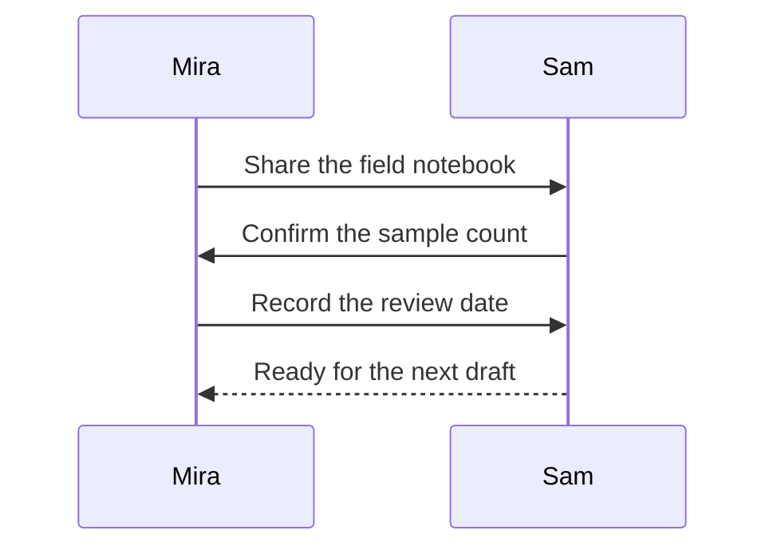

# Review Handoff

A small sequence diagram keeps the conversation and its order together. Open Preview to render it.

## Decisions

1. Keep metadata alongside the note
2. Use local diagrams for repeatable processes
3. Save the source so the next person can edit it

Next: [[Projects/Trailhead Release Flow]] and [[Reference/Source Editing Practice]].