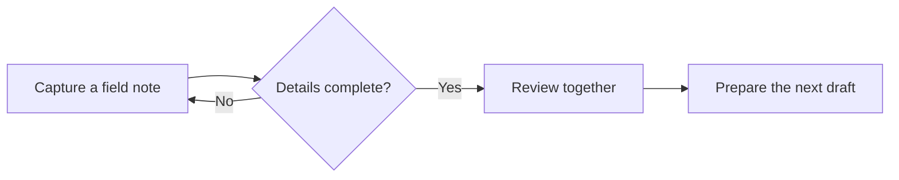

# Trailhead Release Flow

Switch to **Preview** to see this workflow. In Write, the same block remains editable diagram source.

## Review priorities

- Keep the original notes readable
- Make one small change at a time
- Check the result before sharing

The handoff conversation is in [[Meetings/2026-10-20 Review Handoff]]. Sample metadata lives in [[Lab/Typed Properties Lab]].